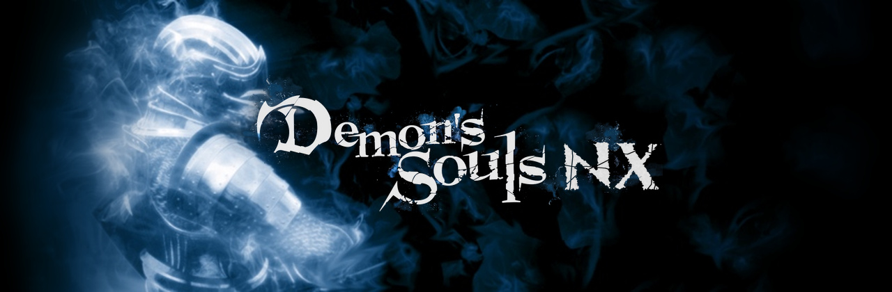

<div align="center">



# DemonSoulsNX

**Demon's Souls (2009) on Nintendo Switch**

Unofficial Nintendo Switch port of **Demon's Souls** (PS3, 2009), built on
[Soulbrandt](https://github.com/JonathanDC64/Soulbrandt) and its
[ps3recomp](https://github.com/JonathanDC64/ps3recomp) runtime: the game's own code, recompiled
to run natively, with a [deko3D](https://github.com/devkitPro/deko3d) renderer.

[](#)
[](#)
[](docs/architecture.md)
[](third_party/README.md)
[](../../releases/latest)

</div>

---

> [!WARNING]
> Early work: stage 3 of the [roadmap](docs/status.md). The game does not run yet. Today's NRO
> checks the console and your game's files, and writes a log.

This repository has no game files and no game code. You need your own copy of Demon's Souls.

## What you need

- A Switch with Atmosphère and a homebrew menu (hbmenu or [sphaira](https://github.com/ITotalJustice/sphaira))
- Your own copy of **Demon's Souls** for the PS3: the US disc, **BLUS30443**, version 1.00, as a
  decrypted disc image (`.iso`) or as a folder with `PS3_GAME` in it
- About 8.5 GB free on the SD card (FAT32 or exFAT)

On a PC: Python 3 and [devkitPro](https://devkitpro.org/wiki/Getting_Started) with `switch-dev`.
Later stages also need your own [RPCS3](https://rpcs3.net), once, to decrypt two files: the game's
code (`EBOOT.BIN`) and `libsre.sprx` from PS3 firmware 4.93.

## Installing

1. Extract your disc:

   ```bash
   python tools/extract_game.py "<your disc>.iso" game_data/disc
   ```

   It checks that the disc is BLUS30443 1.00 and leaves out the disc's system update.
2. Put the game's script files where the port reads them (and, later, what RPCS3 decrypted):

   ```bash
   python tools/check_inputs.py [the folder RPCS3 wrote to]
   ```

3. Build the NRO (see [Building](#building)), then fill `SD_CARD/`:

   ```bash
   python tools/make_sd.py
   ```

4. Copy what is inside `SD_CARD/` to the root of your SD card.
5. Start **Demon's Souls** from the homebrew menu. For the full memory the game needs, start it
   through a forwarder or with title takeover (hold **R** on a game), not from the album.

## Logs

The port writes to `sd:/switch/demonsouls/SD_LOG/`:

| File | What it is |
| --- | --- |
| `demonsouls_log.txt` | everything the port printed (`demonsouls_log_previous.txt` is the last run) |
| `demonsouls_crash.txt` | a crash: the address, the call stack, the registers |
| `demonsouls_fatal.txt` | a fatal error's message |

Copy them to `SD_LOG/` in this repository to look at them. For a live log, start the port with
`nxlink -s demonsouls.nro`. More in [docs/testing.md](docs/testing.md).

## Status

| Area | State |
| --- | --- |
| Extraction from the disc, file layout | Works |
| Sources: Soulbrandt and ps3recomp, pinned, without keys | Done |
| First-boot NRO (logs, memory check, game folder check) | Works on a console (firmware 22.5.0) |
| The PS3's 4 GB address space on the Switch | Works on a console |
| The game's files on the Switch (paths, inflating, SD card speed) | Works on a console |
| The game's code on ARM64 and Horizon | **To do** |
| deko3D renderer | **To do**; its base (device, swapchain, uam shaders) works on a console |
| Online play (co-op, invasions, messages) | **To do** |
| 30 fps at 1020/460/1331 MHz | **Not measured yet** |

The full roadmap, and what has been checked and how, is in [docs/status.md](docs/status.md).

## Building

With devkitPro's `switch-dev`, from its MSYS2 shell, or from the `devkitpro/devkita64` container:

```bash
./build.sh
```

The result is `build/demonsouls.nro`. How the port is put together is in
[docs/architecture.md](docs/architecture.md), and what is on the disc in [docs/assets.md](docs/assets.md).

**Never share a build of the full game.** From stage 4 on, the NRO holds code recompiled from your
copy. Only the tools and the runtime can be shared; the game is built on your PC.

## Credits

- [JonathanDC64](https://github.com/JonathanDC64) for Soulbrandt, and its fork of ps3recomp
- [sp00nznet](https://github.com/sp00nznet) and the contributors of [ps3recomp](https://github.com/sp00nznet/ps3recomp)
- [fincs](https://github.com/fincs) and the devkitPro team for deko3D, uam and libnx
- FromSoftware, for the game

## License

MIT, for this repository's own code, like Soulbrandt and ps3recomp ([LICENSE](LICENSE)). The
projects in `third_party/` keep their own licenses.

Demon's Souls is a trademark of Sony Interactive Entertainment. This project is not affiliated with
or endorsed by Sony Interactive Entertainment, FromSoftware or Atlus, and includes no game files,
no game code, no firmware and no keys.
